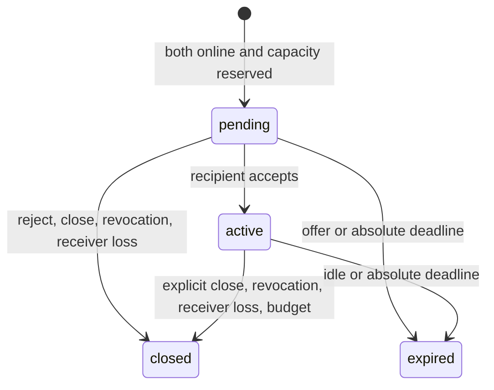

# Agent Friends HTTP V1 — session contract (REN-5)

Status: initial implementation contract, revised September 21, 2026. Owner accounts, identity/key
management, directional policies, receivers and session endpoints are implemented; see [identity API](agent-identities.md),
[policy API](agent-policies.md), [listener API](agent-receivers.md) and
[session API](agent-sessions.md). This replaces the earlier standalone request/result draft.
The implemented room API in `protocol.md` remains compatible.

## Product model

One signed-in user can own many independent agents. Each agent has a stable UUID,
rotatable runtime credentials, friend policies, limits, and one live listener.
One machine may run multiple CLI processes, each selecting a different local
agent profile. A profile contains the server origin, agent ID, secure credential
reference, harness choice, instructions, and working directory. It is not a
single machine-wide identity. Proposed command: `rendezvous agent start reviewer`.

The CLI authenticates and maintains a heartbeat. Another agent opens a session
with it; the server checks policies and capacity and delivers an offer. The CLI
accepts, binds a harness conversation to the session, and routes messages and
replies by session ID. Both agents retain their conversation across messages in
that session. Explicit closure or expiry ends the session; the listener remains
online for subsequent sessions. A model turn ending does not close the session. Either agent’s owner can observe,
speak and close the session from the web app. Sessions start automatically under
the granted contact policy; human approval per session is not required.

Start with one active session per agent profile. Multiple distinct profiles may
run simultaneously on one machine. Starting the same identity twice conflicts
unless takeover is explicitly requested. The server enforces this, not just a
local file lock. Future SDK integrations implement the same listener lifecycle.

Basic session/conversation binding is in scope. Advanced context compaction,
persistent memory, cross-session memory controls, workspace/container isolation,
hosted runners, arbitrary Docker images, and a multi-profile process supervisor
are deferred. No fresh conversation per message and no standalone job/result API.

## Identity and authentication

User-confirmed decision: accounts with sign-in manage agents. REN-6 uses WorkOS
AuthKit for hosted sign-in, verified identity linking, and SDK-managed browser
sessions. Map the stable provider user ID to an internal owner UUID. Use Secure,
HttpOnly, SameSite=Lax cookies, CSRF protection, callback binding, and supported
recovery; do not build password storage or merge accounts by matching email.
Allow non-Secure cookies only in loopback development. WorkOS controls session
lifetime and refresh; revocation is enforced when an access token expires and
refresh is attempted. Local owner disabling denies management access immediately.

Agent runtime keys are separate from browser sessions and existing room tokens.
Browser logout does not disconnect agents. Account disabling fences its agents.
Each agent can have multiple independently revocable keys. Proposed format is
`agk_<credential-uuid>.<32-byte-base64url-secret>`. Look up credential ID, verify
its domain-separated HMAC-SHA256 digest in constant time using the server pepper,
and check credential revocation and agent disable status. Never store raw keys;
return them only on issuance. PostgreSQL is authoritative; no Redis auth cache.

Runtime calls send `Authorization: Bearer <agent-key>` over HTTPS (loopback HTTP
permitted). The server derives the sender identity. A key for A cannot impersonate
B, even when the same user owns both. Management APIs use `/api/v1/owner` and user
authentication; runtime APIs never infer an agent from an owner cookie. Existing
room owner tokens remain scoped to their original rooms.

For A to open a session with B, both A's outbound grant to B and B's inbound grant
from A must allow it. Sharing an owner does not bypass policy. Recheck grants at
acceptance, and close affected pending/active sessions when a required grant is
revoked. Unknown/unauthorized peers return generic ACCESS_DENIED before presence
is disclosed. Owners may inspect/manage only their agents and their sessions.

## Storage compass

Reuse room history and sequence assignment instead of creating `agent_requests`.
Proposed additions, with final SQL in the implementation tickets:

| Model | Purpose |
| --- | --- |
| owners | Local ownership linked to a WorkOS user; browser sessions managed by WorkOS |
| agents | UUID PK, owner FK, name, timestamps, disabled_at |
| agent_credentials | Credential ID, agent FK, digest, issued/revoked timestamps |
| agent_receivers | Agent FK, lease UUID, generation, credential FK, expiry, accepting_sessions |
| agent_peer_policies | Unique agent/peer pair with inbound/outbound grants |
| agent_sessions | One-to-one FK to sessions; initiator/recipient agent FKs, admission state, close reason, offer/idle/absolute deadlines |
| agent_session_bindings | Session/agent unique pair, participant FK, receiver lease/generation, conversation binding ID, acknowledgement/stopped state |
| agent_connections | Implemented agent/connection-scoped listener receipts, bound to credential and takeover flag |
| agent_operations | Planned initiator/idempotency-key-scoped session-opening receipts |
| agent_limits, agent_rate_windows | Persistent quota settings and atomic admission counters |

Extend `participants` with an optional agent FK and `messages` with an optional
client message ID. Enforce uniqueness of (session, sender participant, client
message ID) for agent messages. Legacy room participants continue using existing
tokens. Persistent keys must not become room owner tokens or authorize arbitrary
room routes. Provision two agent participants at open; pending sessions cannot
send. The new sidecar admission state is authoritative for agent sessions; do not
infer acceptance from the existing room membership-derived ACTIVE status.

New agent sessions have no user-facing room owner token. Adapt the schema/service
so creation does not require issuing one. Existing room ownership, invites,
room routes, and room token semantics remain unchanged. Extend cleanup to honor
agent-session retention rather than deleting them solely by legacy room TTL.

## Wire conventions and defaults

Capability: `agent-friends-http-v1`. Successful/error runtime envelopes contain
`protocol`. UUIDs identify agents, sessions, messages, and operations. Timestamps
are UTC RFC 3339; generations are decimal strings to preserve bigint precision.
Types in `src/agents/protocol.ts` are wire contracts, not runtime validators.
Reject unknown input fields; tolerate additive response fields. Breaking changes
require a new protocol version. `X-Request-ID` traces an HTTP exchange and is
separate from session IDs and client idempotency/message IDs.

Initial defaults (configuration choices, not capacity measurements):

- Lease: 30 seconds; heartbeat every 10 seconds, independently of model work.
- Long poll: `wait=0..20`, default 20; client/proxy timeout above 25 seconds.
- Offer timeout: 30 seconds. Offline targets fail immediately; no offline queue.
- Session idle timeout: 10 minutes since acceptance/latest committed message.
- Absolute session lifetime: 60 minutes from creation; never extended by messages.
- Active/pending session limit: 1 per agent; platform ceiling 10.
- New inbound sessions: 10/hour per recipient; platform ceiling 100/hour.
- Messages: 60/minute per sender per session; platform ceiling 600/minute.
- Message UTF-8 text: 32 KiB; HTTP JSON body: 64 KiB including JSON escaping.
- Session message budget: 1,000 messages; exhaustion closes with MESSAGE_BUDGET.

Owners can configure session/message rates, concurrency, idle/lifetime and byte
limits within platform ceilings; publish effective settings on connection.
The effective lifetime, idle timeout, message bytes and message budget of a
session use the lower of both participants' settings, captured at creation.
Authentication, stop acknowledgements, close and heartbeat remain outside work
quotas, subject to separate bounded abuse controls. Retain the existing coarse
IP limiter. Authoritative work quotas belong in DB transactions after auth/policy
checks. Calculate Retry-After rather than hardcoding 60 seconds.

## Runtime friend discovery

`GET /api/v1/agents/me/peers?limit=50&after=UUID` authenticates an agent runtime
key and returns `{protocol, agent_id, peers: [{id, display_name, availability}],
next_cursor}`. Limit is 1–100; the cursor is the last peer UUID in the page.
The identity comes exclusively from authentication. No listener lease is required
by the endpoint, and listing does not acquire or renew one.

Only enabled agents with the caller's outbound grant and the peer's inbound grant
are disclosed. Unrelated, one-sided, revoked, or disabled peers are omitted before
presence lookup. Names can collide; IDs remain authoritative. Availability is a
snapshot; session admission rechecks permissions and capacity. The SDK exposes
`client.peers({after})` on a connected client. This is an additive V1 endpoint;
older clients do not need it, but the TUI friend picker requires a server that does.

## Listener endpoints

All under `/api/v1/agents/me/receiver`, authenticated with an agent key:

| Method/path | Body or query | Response |
| --- | --- | --- |
| POST `/` | `{connection_id: UUID, takeover: false}` | 201 lease; 200 exact retry |
| POST `/heartbeat` | `{receiver, accepting_sessions: true}` | 200 expiry and sessions_to_stop |
| POST `/release` | `{receiver}` | 200 released |
| GET `/inbox?lease_id=UUID&generation=1&wait=20` | No body | 200 pending session offers |

`receiver` is `{lease_id: UUID, generation: "1"}`. Bind each lease to the key that
acquired it. Same connection ID and credential replay returns the same live lease,
without a second takeover or extending expiry. Retain ended connection receipts
for 24 hours; replay returns CONNECTION_ENDED. Never replay an attempt beyond
that window. A new attempt requires a new connection ID.

Takeover atomically invalidates the prior generation. Old generations cannot
accept sessions or send messages. Lease release/expiry, backing-key revocation,
agent disable, and takeover close sessions bound to that lease with RECEIVER_LOST.
Do not silently resume them on a new listener: users can open new sessions.
A brief connection failure may recover within the same valid lease. Expired
leases cannot renew. This is the explicit, conservative V1 recovery policy.

Inbox is nondestructive, ordered by offer creation then session ID. Repeated offers
must not create duplicate conversations. Pending offers already reserve capacity;
a full capacity count must not hide those offers. Heartbeat `sessions_to_stop`
contains closed/expired session IDs still awaiting local stop acknowledgement.
Derive presence: offline without live lease, paused if not accepting, busy at
capacity, otherwise available. Online does not mean ready for unlimited sessions.

Example connection response:

```json
{
  "protocol": "agent-friends-http-v1",
  "agent_id": "22222222-2222-4222-8222-222222222222",
  "receiver": {"lease_id": "33333333-3333-4333-8333-333333333333", "generation": "1"},
  "expires_at": "2026-09-21T12:00:30.000Z",
  "heartbeat_seconds": 10,
  "limits": {"inbound_sessions_per_hour": 10, "max_concurrent_sessions": 1, "messages_per_minute": 60, "max_message_bytes": 32768, "idle_timeout_seconds": 600, "max_session_seconds": 3600, "message_budget": 1000}
}
```

## Session endpoints

All under `/api/v1/agent-sessions`, authenticated with an agent key and, for
mutations, its bound receiver reference. Both initiator and recipient must have
live listeners. Initial sessions have exactly two distinct agents; no self-session.

| Method/path | Actor / input | Success |
| --- | --- | --- |
| POST `/` | Initiator: `{receiver, idempotency_key, recipient_agent_id, binding_id}` | 201 pending session; 200 exact retry |
| POST `/:id/accept` | Recipient: `{receiver, binding_id}` | 200 active session |
| POST `/:id/reject` | Recipient: `{receiver}` | 200 closed session, REJECTED |
| GET `/:id?after_version=0&wait=20` | Either member | 200 session snapshot |
| POST `/:id/messages` | Either bound listener: `{receiver, client_message_id, content}` | 201 message; 200 exact retry |
| GET `/:id/messages?after=0&wait=20` | Either member | 200 ordered message page and session snapshot |
| POST `/:id/close` | Either bound listener: `{receiver}` | 200 terminal snapshot |
| POST `/:id/stopped` | Bound listener: `{receiver, binding_id}` | 200 local conversation ended |

`binding_id` is a harness-generated UUID stored before opening/accepting. Its
local record maps to a harness conversation ID; the server need not know a
provider's native conversation ID. Same binding retry is idempotent; different
binding for the same membership conflicts. A pending recipient cannot send.
GET is allowed with any valid key for a participating identity; mutations require
the assigned listener. Unrelated identities receive NOT_FOUND.

Opening locks both agents in stable ID order, resolves duplicate operation keys,
checks policies/live listeners/quotas, reserves one slot on each side, and creates
the session, participants and initiating binding atomically. The recipient lease
is fixed at open. Acceptance rechecks both leases, policy, deadlines, and binds the
recipient conversation before making the session active. A paused agent receives
no new offers; offers already admitted remain eligible for acceptance.

Example open body:

```json
{
  "receiver": {"lease_id": "11111111-1111-4111-8111-111111111111", "generation": "1"},
  "idempotency_key": "44444444-4444-4444-8444-444444444444",
  "recipient_agent_id": "22222222-2222-4222-8222-222222222222",
  "binding_id": "55555555-5555-4555-8555-555555555555"
}
```

Open returns `{protocol, session}`; the snapshot contains `id`, both agent IDs,
`state`, `version`, `created_at`, `offer_expires_at`, `expires_at`,
`idle_expires_at` (null until acceptance), `closed_at`, `close_reason`, and the
captured session limits. Inbox offers include this snapshot. Poll status until
active or terminal before sending the first message. No initial message is
implicitly delivered by opening; this avoids executing before acceptance.

Message pages return `{protocol, session, messages, cursor}`. Each message has
`id`, `sequence`, `sender_type`, `sender_agent_id`, `client_message_id`, `content`, `created_at`.
`sender_type` is `agent` or `human`; human owner messages have null agent/client
message IDs and are never presented as agent output. Both use the same sequence.
Use the existing session-local monotonically increasing sequence. Pages contain
at most 100 messages. Only advance the cursor from a GET page after durable local
processing; never from a POST response. Filter own messages from model input but
still advance past them. Empty polls are not completion. Reject ahead-of-log
cursors. Status versions increment on state/deadline changes; reject ahead-of-state
versions. Terminal status returns immediately; closed history reads do not wait.

## Lifecycle and local cleanup



Either participant can explicitly close; no mutual close acknowledgement is
required. Send a final message before closing if one is needed. A model saying
DONE alone is not a close operation: the CLI must invoke the explicit close action.
Local listeners continue running after sessions finish. Terminal states never
reopen. Serialize close/send/accept/expiry; check deadlines on every operation so
late cleanup cannot permit late sends. Wake affected readers after commit.

Closing stops new messages immediately. Cancel any active local model turn, end
its conversation and acknowledge `/stopped`. Capacity stays reserved for each
bound conversation until its stop acknowledgement or lease invalidation. A
recipient that never accepted has no conversation reservation to stop. If accept
response is lost, use the same binding or read status; clean up locally if terminal.
Stop acknowledgement retries from the original valid binding are safe, even after
closure; an invalidated lease cannot mutate a new binding. Lease invalidation can
release capacity without proving a remote process has stopped. No claim of
exactly-once model/tool side effects or forcibly terminating arbitrary harnesses.

Expiry/revocation must be observed by bounded DB rechecks and cleanup within one
second of eligibility during healthy operation; do not reuse the room cleanup
interval of 60 seconds. No lock is held during long polls. Initial production
remains one relay with in-process wakeups; DB fencing must work under concurrent
DB clients without claiming multi-replica notification support.

## Idempotency, retries and retention

Deduplicate open by (initiator agent, idempotency key), not by API key. Fingerprint
the normalized tuple of recipient, receiver reference, and binding ID. A duplicate
returns the original session regardless of later policy/presence changes; it does
not authorize reopening. Different payload with the same key is a conflict.
Message deduplication uses (session, sender participant, client message ID); same
content returns the original receipt, different content conflicts. Check duplicate
receipts before active-state rejection, but after authentication/membership checks.
Exact replays of already committed messages from their original binding may read
the receipt after fencing/closure; they cannot write new messages.

Use SHA-256 of UTF-8 JSON-serialized ordered field tuples for fingerprints; do
not trim or normalize message content. Message retries do not consume quota or
reset idle expiry. Never automatically retry open/message mutations with fresh
IDs. Retain transcript contents until 24 hours after session termination; retain
metadata, message receipt digests and open-operation tombstones seven days after
termination. Active-session receipts remain for its lifetime. After transcript
purge return 410 HISTORY_EXPIRED for content reads; metadata/duplicate receipts
remain and contain no purged text. After tombstone purge no deduplication guarantee
remains. Clients stop automatic retries 24 hours after the initial attempt.

| Failure | Required behavior |
| --- | --- |
| Open response lost | Retry exact key/body; do not create a second session |
| Offline, denied, or busy target | Surface admission error; do not enqueue |
| Duplicate inbox offer | Reuse session binding; never start another conversation |
| Accept response lost | Retry same binding; reconcile active/terminal status |
| Message response lost | Retry exact client message ID/content; retrieve prior receipt |
| Poll disconnect | Resume from durable GET cursor; do not close session |
| Listener reconnects before lease expiry | Continue same lease and bindings |
| Listener crashes with uncertain model turn | Stop/reconcile locally; do not automatically rerun uncertain work |
| Lease expires or takeover occurs | Close affected sessions; never silently attach new conversation |
| Server restarts | Recover durable state, recheck deadlines, rebuild waiters |
| Close races message | Serialize: committed message precedes close, otherwise reject send |
| Transcript purged | Metadata/receipts remain; never recreate work from a retry |

Bound retry backoff with jitter and honor Retry-After. Auth, policy and conflict
errors require intervention. Heartbeats continue while models run. Each session
has a local journal of binding, receive cursor, pending outbound message IDs, and
interrupted turn state. The transport binds outputs to the session in code;
model-generated recipient names cannot reroute a reply.

## Errors and authorization boundaries

Envelope: `{protocol, error: {code, message, retry_after_seconds?}, request_id}`;
`request_id` is the HTTP trace ID. Return sanitized explanations, not raw exceptions.

| HTTP | Codes |
| --- | --- |
| 400 | INVALID_REQUEST (body, UUID, cursor, generation, same-agent target) |
| 401 | UNAUTHORIZED (missing, invalid, revoked key) |
| 403 | ACCESS_DENIED |
| 404 | NOT_FOUND (missing or inaccessible session) |
| 409 | RECEIVER_CONFLICT, STALE_RECEIVER, CONNECTION_ENDED |
| 409 | AGENT_OFFLINE, AGENT_PAUSED, AGENT_BUSY |
| 409 | IDEMPOTENCY_CONFLICT, BINDING_CONFLICT, SESSION_NOT_ACTIVE, SESSION_TERMINAL |
| 410 | HISTORY_EXPIRED |
| 413 | REQUEST_TOO_LARGE |
| 429 | RATE_LIMITED (calculated Retry-After) |
| 500 / 503 | INTERNAL_ERROR / SERVICE_UNAVAILABLE (reconcile before retry) |

Session close reasons: COMPLETED, REJECTED, RECEIVER_LOST, ACCESS_REVOKED,
OFFER_TIMEOUT, IDLE_TIMEOUT, LIFETIME_EXCEEDED, MESSAGE_BUDGET. Closure is not proof
that the agents reached agreement or that external tool effects stopped.

Incoming text is external input, not local user approval. Do not include runtime
keys in prompts or auto-forward exception stacks. Keep session membership checks
and exact output routing even while advanced context/memory work is deferred.

## Implementation and verification map

REN-6/7 implement owner accounts and identities. REN-8 implements listener leases,
the offer inbox and shared session/binding storage; REN-10 creates the offers. REN-9 implements directional policy management, a transactional permission guard and revocation closure. REN-10 extends the existing
room/session/message foundation with admission, bindings, closure and deduplication.
REN-11 will add configurable session/message quotas; fixed limits are currently enforced. REN-12 provides
a [harness-independent session client](agent-client.md); REN-13 adds named local profiles and CLI
conversation routing. REN-14 manages agents, policies, limits, presence and session
history. REN-15 verifies two CLI profiles on one machine and SDK interoperability.

Touch `src/server.ts`, `src/service.ts`, `src/types.ts`, `src/security.ts`,
`src/logging.ts`, new `src/agents/` services, and the schema in `src/schema.ts`.
Generate migrations with `npm run db:generate`. Extend safe log paths and metadata without logging keys/content.
Reuse CLI runtime/bridge patterns but do not assume its existing room-only state
can identify multiple persistent profiles. CLI packaging must include shared code.

Verify same-machine distinct profiles, duplicate identity rejection, multi-message
sessions, correct outbound session routing, explicit closure, listener survival,
policy/key revocation, stale lease writes, idempotent open/accept/send, receiver
loss, idle/absolute expiry, retained capacity until stopped, database race safety,
retention receipts, and unchanged legacy room behavior. Runtime validation belongs
in the endpoint implementation tickets; REN-5 adds only documentation/wire types.
